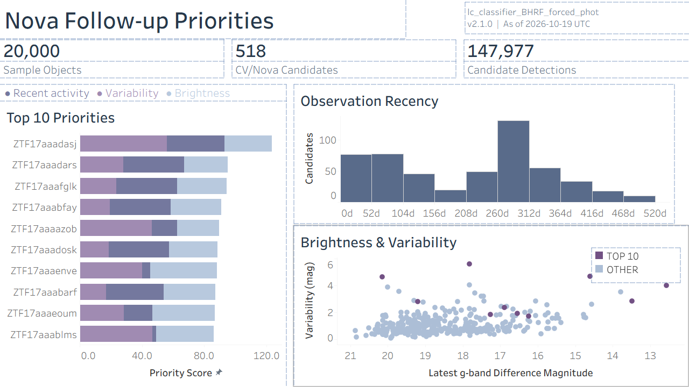

# Nova Follow-up Priorities

An astronomy data analytics portfolio project using Python, PostgreSQL, and Tableau to explore CV/Nova candidates and rank 10 targets for follow-up consideration.

## Data Source

Observations originate from the [Zwicky Transient Facility (ZTF)](https://www.ztf.caltech.edu/) and were downloaded through the [ALeRCE public TAP service](https://science.alerce.online/services/accessing-data-tap/) using `pyvo`.

TAP endpoint: `https://tap.alerce.online/tap`

The project uses three ALeRCE tables:

- `ztf.object`: object identifiers, coordinates, detection counts, and observation dates.
- `ztf.detection`: individual photometric measurements, observation times, filters, and difference-flux signs.
- `ztf.probability`: class probabilities supplied by ALeRCE classifiers.

CV/Nova candidates were selected where the highest-ranked class was `CV/Nova` under **`lc_classifier_BHRF_forced_phot`, version `2.1.0`**. The final dashboard summarizes **20,000 sample objects**, **518 CV/Nova candidates**, and **147,977 candidate detections**, with recency measured relative to **October 19, 2026 (UTC)**.

## Workflow

1. **Python:** download batches, normalize columns, convert MJD to UTC, and save cleaned Parquet files.
2. **PostgreSQL:** select candidates and aggregate observation history, brightness, and variability.
3. **Jupyter notebooks:** explore the data, calculate priority scores, and export CSV files for Tableau.
4. **Tableau:** show observation recency, brightness versus variability, and the Top 10 with separate score contributions for recent activity, variability, and brightness.

## Files

- [Tableau dashboard](CV_Nova_final.twbx)
- [SQL analysis](notebook/05_sql_operations.sql)
- `notebook/`: data exploration, validation, cleaning, PostgreSQL loading, and Tableau data preparation/export.
- `src/` and `script/`: data extraction and cleaning code.
- `data/processed/`: CSV outputs used in Tableau.

